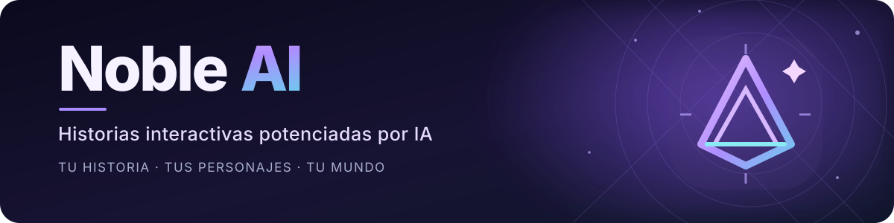
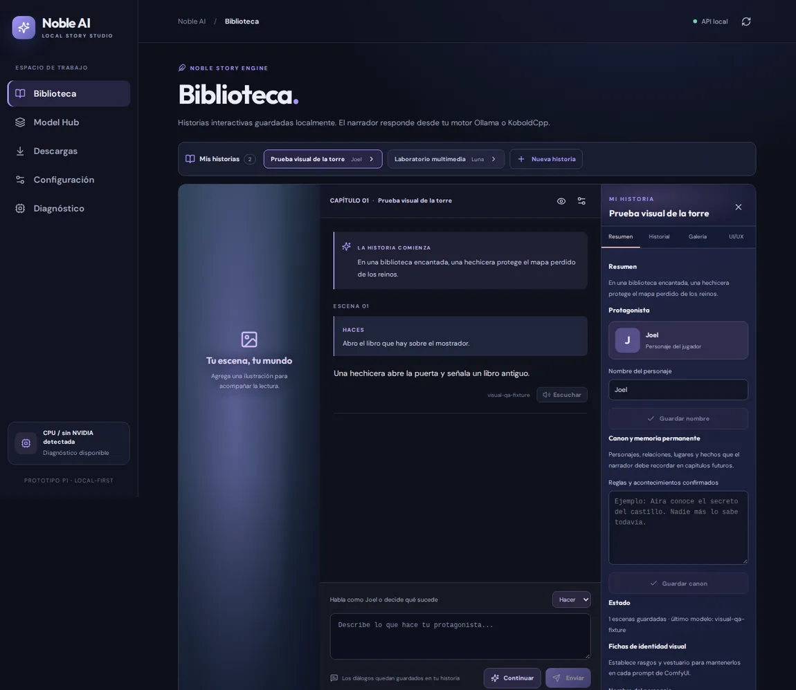
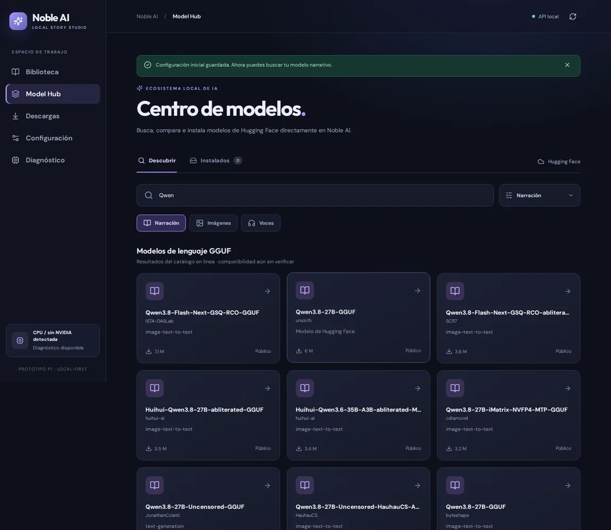
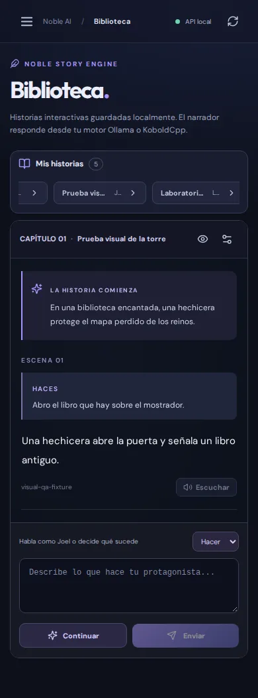
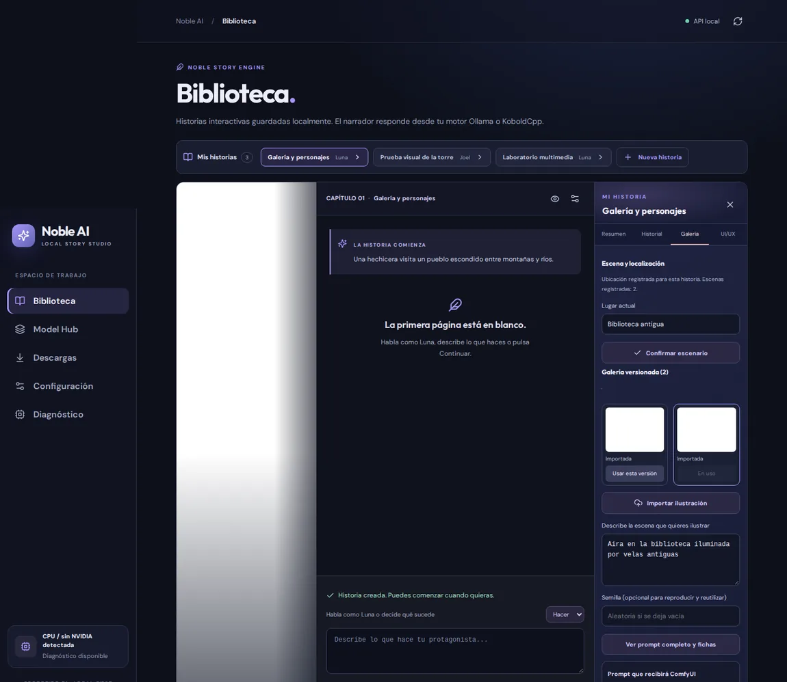
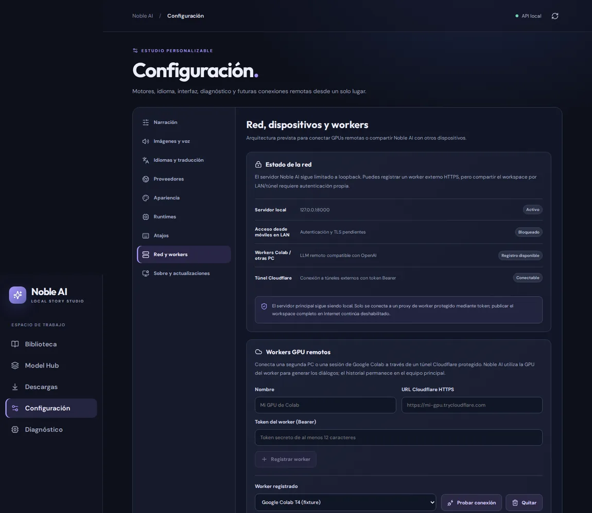
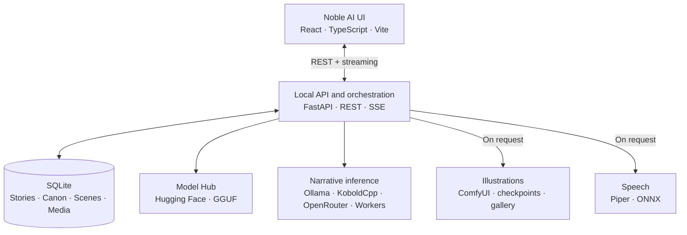
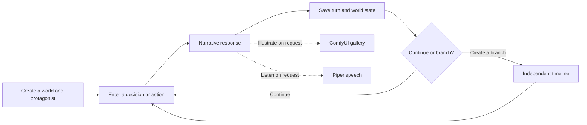

<div align="center">



[](https://github.com/Mairon31/novel_ai/actions/workflows/p0-docs.yml)
[](https://www.python.org/)
[](https://react.dev/)
[](https://fastapi.tiangolo.com/)
[](https://github.com/Mairon31/novel_ai/stargazers)

**Create worlds. Meet characters. Change the story.**

**Noble AI** is a local-first interactive story and visual novel studio. Create original worlds, direct your protagonist, explore branching narratives, and connect language, image, and speech models without tying your stories to a single inference provider.

[**Explore**](#the-experience) · [**Get started**](#get-started) · [**Features**](#features) · [**Contribute**](#contributing)

</div>

---

## The experience

Noble AI follows an **app-first** approach: it is designed around the **application**, not a notebook or terminal. Its local web interface brings together a story library, a responsive reader, Creator Studio, Model Hub, visual media tools, and separate settings for each system.

<div align="center">
  
  <sub>Desktop reader — screenshot captured during automated development testing</sub>
</div>

<br />

<table>
  <tr>
    <td width="60%" align="center">
      
      <strong>Model Hub</strong><br /><sub>Browse and manage language models.</sub>
    </td>
    <td width="40%" align="center">
      
      <strong>Mobile-friendly reader</strong><br /><sub>Adaptive layouts and controls.</sub>
    </td>
  </tr>
  <tr>
    <td align="center">
      
      <strong>Scenes and characters</strong><br /><sub>Illustration history and visual continuity.</sub>
    </td>
    <td align="center">
      
      <strong>Remote workers</strong><br /><sub>Connect inference engines on another machine.</sub>
    </td>
  </tr>
</table>

<sub>These are screenshots of the actual development UI. Story and model outputs displayed by automated tests are demonstration fixtures, not samples of model quality.</sub>

## Features

| Area | What you can do |
|---|---|
| **Interactive storytelling** | Type actions, dialogue, or decisions and receive streamed narration. Keep the player's choices separate from the narrator's role. |
| **Persistent worlds** | Store stories, characters, canon, turns, world-state snapshots, Lorebooks, episodic search, and independent narrative branches in SQLite. |
| **Creator Studio** | Develop a story premise, openings, character profiles, private creator notes, and visual references. Import or curate editorial media. |
| **Multiple reader layouts** | Switch between visual novel, book, and chat-style reading, with a searchable backlog and optional hidden controls. |
| **Scene illustration** | Connect ComfyUI, choose models and sampling controls, create images on request, reuse gallery results, and manage character appearance references. |
| **Character sprites** | Import expression sheets or generate five expression drafts with ComfyUI, inspect cutouts, and approve assets before they appear in the reader. |
| **Voice playback** | Use Piper voices for explicit, optional playback. Image and voice settings live in separate panels; narration does not synthesize audio merely because a story opens. |
| **Model Hub** | Search Hugging Face GGUF models, inspect variants and hardware-fit estimates, download supported models, and assign an inference provider. |
| **Remote inference** | Connect compatible workers and run selected workloads on another computer, subject to endpoint and authentication settings. |
| **Story Hub** | Install editable copies of the bundled original story worlds. A community publishing service is a future goal, not a released feature. |

Noble AI does not guarantee face identity, visual quality, GPU compatibility, or adherence to character knowledge solely from model prompts. Some integrations are implemented as controlled first versions and still need physical GPU testing.

## Get started

### Run on Windows

Requirements: **Python 3.11+**, **Node.js 22+**, and **Git**. In PowerShell:

```powershell
git clone https://github.com/Mairon31/novel_ai.git
cd novel_ai

py -3.11 -m venv .venv
.\.venv\Scripts\python.exe -m pip install -r apps\api\requirements.txt

npm --prefix apps\web install
npm --prefix apps\web run build

.\.venv\Scripts\python.exe -m uvicorn noble_api.main:app --app-dir apps/api --host 127.0.0.1 --port 8000
```

Open **http://127.0.0.1:8000**. The interface can open before you install a language model. Connect Ollama, configure an existing KoboldCpp executable with a local GGUF, or use a compatible provider. Image and audio generation are optional and require their corresponding runtimes and models.

### Linux / macOS development

```bash
git clone https://github.com/Mairon31/novel_ai.git
cd novel_ai

python3 -m venv .venv
.venv/bin/python -m pip install -r apps/api/requirements.txt
npm --prefix apps/web install
npm --prefix apps/web run build
.venv/bin/python -m uvicorn noble_api.main:app --app-dir apps/api --host 127.0.0.1 --port 8000
```

See the [quickstart](docs/QUICKSTART.md) for provider setup, data locations, troubleshooting, and test commands.

### Run in Google Colab (optional)

[**Open the Noble AI Colab application notebook**](https://colab.research.google.com/github/Mairon31/novel_ai/blob/master/notebooks/noble_ai_colab_play.ipynb)

The notebook can set up the app and development dependencies in an ephemeral Colab runtime and open the UI through Colab's session proxy. Where resources allow, it can prepare Ollama and attempt ComfyUI setup; actual GPU results must be checked in that runtime. Colab is **not required** for local installation. See the [Colab guide](docs/COLAB_PLAY.md).

## Image generation and checkpoint installation

Noble AI supports a first-party image-checkpoint installer in **Settings → Images**. It can inspect supported public Hugging Face repositories, download individual root-level `.safetensors` checkpoints, verify the published hash and file structure, and manage pause/resume/cancel operations.

Downloaded checkpoints are stored in Noble AI's managed model directory. They become **selectable only after ComfyUI reports them as available**. Noble AI can start and stop an **already installed** ComfyUI process using its managed runtime settings. Installing or upgrading the ComfyUI application itself, broader checkpoint-family support, LoRA/VAE installation, and end-to-end GPU validation remain outstanding.

Read [checkpoint installation](docs/CHECKPOINTS_IMAGEN.md), [ComfyUI integration](docs/COMFY_UI_INTEGRACION.md), and [image controls](docs/CONTROLES_IMAGEN.md).

## Reader, story, and visual tools

The reader supports **VN / Book / Chat** layouts, a searchable backlog, and optional HUD controls. With keyboard shortcuts enabled: `Alt+1/2/3` switches layouts, `Alt+B` opens the backlog, `Alt+H` toggles controls, and `Esc` closes the backlog.

The Visual Director can reuse a registered background by location, time, weather, camera, and lighting context. Sprites may be attached to characters with a pose and one of five expressions; selection from approved local assets is deterministic. Generating new character art is a separate, manual action, not something silently triggered on every turn.

Creator Studio supports imported expression sheets, optional ComfyUI-generated expression drafts, LoRA references, IPAdapter Plus conditioning, and background-cutout methods including optional RMBG/BiRefNet integrations when their dependencies are installed. Drafts require review and approval. A [local sprite benchmark](docs/GPU_SPRITE_BENCHMARK.md) can record observed timing and VRAM on a real ComfyUI installation; simulated CI results are not physical benchmarks.

Story Hub currently includes three original, installable text-based worlds with alternate openings, characters, and lore. Installing a world creates an editable local copy. See [Story Hub](docs/STORY_HUB.md).

## Architecture



The React application, narrative engine, model management, media services, and storage are separate components. The project targets Windows-first local usage and supports remote inference as an optional extension. A packaged desktop executable is still a roadmap item.


### How a story progresses



## Documentation

| Resource | Purpose |
|---|---|
| [Quickstart](docs/QUICKSTART.md) | Installation, providers, and first story |
| [Architecture](docs/ARQUITECTURA.md) | Services, data flow, and implementation notes |
| [Model Hub](docs/MODEL_HUB.md) | Catalog, installation, and hardware assessment |
| [Images](docs/IMAGENES.md) | ComfyUI, gallery, references, and consistency |
| [Checkpoints](docs/CHECKPOINTS_IMAGEN.md) | Secure checkpoint installation |
| [Speech](docs/TTS.md) | Local speech synthesis |
| [Remote workers](docs/WORKERS.md) | Distributed inference and connectivity |
| [API contracts](docs/CONTRATOS_API.md) | REST endpoints and SSE contracts |
| [Security and licensing](docs/SEGURIDAD_Y_LICENCIAS.md) | Security boundaries and licensing |
| [Roadmap](docs/ROADMAP.md) | Planned milestones |
| [TODO](TODO.md) | Verified implementation checklist |
| [Progress log](docs/PROGRESO.md) | Development and CI evidence |
| [Third-party notices](docs/THIRD_PARTY_NOTICES.md) | Upstream attribution |

The development backlog and historical audit may contain tasks not yet implemented. A successful simulated test does not establish end-to-end model or GPU compatibility.

## Contributing

Contributions to the React UI, Python API, model integrations, accessibility, story tools, design, documentation, and tests are welcome. Browse [issues](https://github.com/Mairon31/novel_ai/issues), read [CONTRIBUTING.md](CONTRIBUTING.md), and propose a focused change.

Noble AI builds on compatible open-source tools and acknowledges relevant sources in [third-party notices](docs/THIRD_PARTY_NOTICES.md).

<div align="center">

**Interested in the project?** [Star Noble AI on GitHub](https://github.com/Mairon31/novel_ai) or contribute an issue, design, test, or code change.

<sub>Made for stories that have not been told yet.</sub>

</div>
