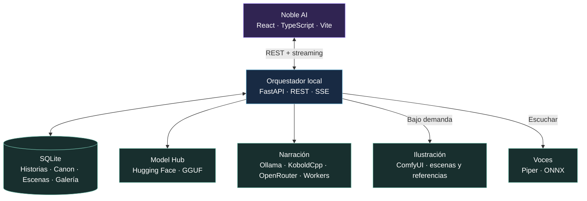
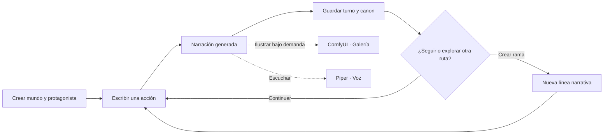

<div align="center">


<br />

[](https://github.com/Mairon31/novel_ai/actions/workflows/p0-docs.yml)
[](https://www.python.org/)
[](https://react.dev/)
[](https://fastapi.tiangolo.com/)
[](https://github.com/Mairon31/novel_ai/stargazers)

**Crea historias que responden a tus decisiones.**  
Un lector de novelas visuales con modelos de lenguaje, ilustraciones y voces conectables, donde tú controlas al protagonista y el mundo evoluciona con tus elecciones.

[**Explorar la interfaz**](#-la-aplicación) · [**Instalar**](#-primeros-pasos) · [**Arquitectura**](#-arquitectura) · [**Contribuir**](#-contribuir)

</div>

---

## ✨ La aplicación

Una experiencia **app-first**: Noble AI se utiliza desde su interfaz web local, con biblioteca de historias, lector interactivo, modelos configurables y herramientas creativas. **Google Colab es opcional** para trabajadores remotos o pruebas de desarrollo; no es necesario para abrir la aplicación.

<div align="center">
  
  <sub>Biblioteca y lector narrativo · captura de la interfaz web durante pruebas de desarrollo</sub>
</div>

<br />

<table>
  <tr>
    <td align="center" width="60%">
      
      <br /><b>Model Hub</b><br /><sub>Descubre y administra modelos de lenguaje.</sub>
    </td>
    <td align="center" width="40%">
      
      <br /><b>Experiencia móvil</b><br /><sub>Lectura y controles adaptables.</sub>
    </td>
  </tr>
  <tr>
    <td align="center">
      
      <br /><b>Escenas y personajes</b><br /><sub>Galería de versiones y continuidad visual.</sub>
    </td>
    <td align="center">
      
      <br /><b>Workers remotos</b><br /><sub>Conexión a motores en otros equipos.</sub>
    </td>
  </tr>
</table>

<sub>Las imágenes anteriores provienen de capturas automatizadas de la aplicación real. Los escenarios y respuestas de los recorridos visuales son datos de demostración, no ejemplos de calidad de un modelo.</sub>

## 🌌 Qué ofrece Noble AI

| | Funcionalidad | |
|:---:|---|---|
| 📖 | **Narración interactiva** | Escribe lo que dices, haces o decides. El narrador responde progresivamente, sin controlar las decisiones de tu protagonista. |
| 🗺️ | **Mundos persistentes** | Guarda historias, premisas, personajes, canon, historial y rutas alternativas que pueden continuar de forma independiente. |
| 🎨 | **Ilustraciones por escena** | Conecta ComfyUI, crea imágenes bajo demanda, consulta una galería de versiones y reutiliza resultados por semilla. |
| 🧑‍🎨 | **Identidad visual** | Define vestuario, apariencia y rasgos de personajes, que se incorporan a los prompts cuando aparecen en la escena. |
| 🎙️ | **Voz opcional** | Escucha turnos guardados con Piper y voces ONNX locales; sin reproducción o síntesis automática al abrir una historia. |
| 🧠 | **Modelos a tu elección** | Utiliza Ollama, KoboldCpp, OpenRouter o un worker compatible. Busca y descarga GGUF desde el Model Hub. |
| 🌐 | **Desde más dispositivos** | Interfaz adaptable a escritorio y móvil; workers de inferencia autenticados mediante conexiones remotas. |
| ⚙️ | **Preferencias propias** | Ajusta idioma de salida, estilo narrativo, generación de imágenes, parámetros de modelo y apariencia. |

## 🧩 Arquitectura

Noble AI separa la interfaz del motor narrativo, los servicios multimedia y la persistencia. Cada proveedor se conecta de forma independiente y se ejecuta cuando se solicita su función.



### Cómo fluye una historia



## 🚀 Primeros pasos

Noble AI se ejecuta como **aplicación web local**. Para desarrollarla o probarla necesitas **Python 3.11+**, **Node.js 22+** y **Git**.

<details open>
<summary><b>Windows · PowerShell</b></summary>

```powershell
git clone https://github.com/Mairon31/novel_ai.git
cd novel_ai

py -3.11 -m venv .venv
.\.venv\Scripts\python.exe -m pip install -r apps\api\requirements.txt

npm --prefix apps\web install
npm --prefix apps\web run build

.\.venv\Scripts\python.exe -m uvicorn noble_api.main:app --app-dir apps/api --host 127.0.0.1 --port 8000
```

</details>

<details>
<summary><b>Linux · macOS (entorno de desarrollo)</b></summary>

```bash
git clone https://github.com/Mairon31/novel_ai.git
cd novel_ai

python3 -m venv .venv
.venv/bin/python -m pip install -r apps/api/requirements.txt

npm --prefix apps/web install
npm --prefix apps/web run build

.venv/bin/python -m uvicorn noble_api.main:app --app-dir apps/api --host 127.0.0.1 --port 8000
```

</details>

Abre **[http://127.0.0.1:8000](http://127.0.0.1:8000)**. Configura un motor narrativo, crea una historia desde **Biblioteca** y empieza a interactuar con ella. Para ejecutar modelos locales necesitas Ollama o un ejecutable compatible de KoboldCpp; ComfyUI y Piper se instalan por separado si quieres ilustraciones o voces.

Consulta la [guía de instalación y conexión de modelos](docs/QUICKSTART.md) para ver el proceso completo.

### Proveedores

| Función | Integración | Funcionamiento |
|---|---|---|
| Narración | **Ollama**, **KoboldCpp** | Motor local, con modelos instalados por separado |
| Narración por API | **OpenRouter** | Cuenta y API key del proveedor |
| Inferencia remota | **Noble AI Workers** | Equipo externo o GPU remota con autenticación |
| Ilustraciones | **ComfyUI** | Checkpoint local; generación explícita y galería |
| Voz | **Piper** | Voces locales ONNX; reproducción bajo demanda |

La aplicación no descarga automáticamente todos estos motores. Sus configuraciones, modelos compatibles y requisitos dependen del proveedor.

## 📚 Documentación

**Auditoría y tareas de desarrollo:** [TODO verificable](TODO.md) · [Auditoría integral Argon](docs/ARGON_AUDITORIA.md) · [Hoja de ruta](docs/ROADMAP.md) · [Bitácora de cambios y pruebas](docs/PROGRESO.md). La auditoría es una evaluación estática; el TODO diferencia capacidades presentes, implementaciones pendientes y validación física de GPU.


| Guía | Descripción |
|---|---|
| [Primer inicio](docs/QUICKSTART.md) | Instalación, Model Hub y narrador |
| [Arquitectura](docs/ARQUITECTURA.md) | Organización de servicios y responsabilidades |
| [Escenas e imágenes](docs/IMAGENES.md) | ComfyUI, galería, continuidad y caché |
| [Integración multimedia](docs/MULTIMEDIA_LOCAL.md) | Conectar ComfyUI y Piper |
| [Workers](docs/WORKERS.md) | Inferencia en otros equipos y Colab |
| [API](docs/CONTRATOS_API.md) | Rutas REST y streaming SSE |
| [Seguridad](docs/SEGURIDAD_Y_LICENCIAS.md) | Datos, permisos y uso de componentes |

Para conocer tareas de implementación e incidencias, visita [GitHub Issues](https://github.com/Mairon31/novel_ai/issues). Los detalles de ingeniería se mantienen en la documentación técnica, no en esta página de presentación.

## 🤝 Contribuir

Noble AI busca reunir una buena experiencia de novela visual con modelos abiertos, generación de imágenes, voz y herramientas que funcionen en distintos equipos. Las contribuciones de desarrollo web, Python, IA, accesibilidad, diseño, documentación y pruebas son bienvenidas.

Puedes comenzar revisando [issues abiertas](https://github.com/Mairon31/novel_ai/issues), proponiendo una mejora o enviando un pull request. Lee la [guía de contribución](CONTRIBUTING.md) antes de publicar cambios importantes.

<div align="center">

### ⭐ ¿Te interesa Noble AI?

**Si el proyecto te resulta útil o quieres apoyar su desarrollo, deja una estrella en GitHub.**  
Y si quieres ayudar a construirlo, abre una propuesta, reporta un problema o colabora con código, diseño o documentación.

[](https://github.com/Mairon31/novel_ai)
[](https://github.com/Mairon31/novel_ai/issues)

<sub>Hecho para dar vida a historias que todavía no existen.</sub>

</div>


---

## Lectura VN / Libro / Chat y director de fondos

En el lector, **UI/UX** permite elegir **VN** (escenario e historia), **Libro** (narración continua) o **Chat** (turnos separados en burbujas). La selección queda persistida en las preferencias locales. El botón **Backlog** abre las escenas cargadas de la ruta actual con búsqueda y salto al turno. También puedes ocultar el HUD sin perder la narración y restaurarlo con el botón flotante. Con los atajos habilitados: `Alt+1/2/3` cambia de vista, `Alt+B` abre el backlog, `Alt+H` oculta/revela los controles y `Esc` cierra el backlog.

Desde **Galería → Director visual**, Noble evalúa si conviene reutilizar un fondo ya registrado o preparar uno nuevo. Permite registrar manualmente una versión de galería como fondo para un contexto de lugar, hora, clima, plano e iluminación, y seleccionarla otra vez sin procesar GPU. Los cambios de emoción no invalidan la caché del paisaje; las acciones de sprites y CG son propuestas para funciones futuras, **no generaciones automáticas**. La indexación de fondos manuales sigue las historias y sus archivos `.noble.zip`.

Ver [arquitectura](docs/ARQUITECTURA.md), [QA](docs/QA_Y_ACEPTACION.md) y [CI #42127083317](https://github.com/Mairon31/novel_ai/actions/runs/42127083317).


## Escenario visual con sprites y expresiones

En **Creator Studio → Imágenes**, importa retratos PNG con transparencia, enlázalos a los NPC y selecciona una de cinco expresiones (neutral, alegría, enojo, tristeza o sorpresa) y una pose. Al avanzar la historia, el lector VN reutiliza las imágenes disponibles para mostrar hasta tres personajes; selecciona la variante a partir de pistas en el texto narrado y conserva una expresión neutral cuando no existe una alternativa. Los personajes no aparecen por mencionar su nombre únicamente en el contexto oculto del creador.

La puesta en escena distingue al hablante solo cuando el narrador le atribuye explícitamente una intervención. Incluye fondo, transiciones entre dos imágenes, iluminación del personaje que habla y caja inferior con la narración. Las imágenes originales no se regeneran para cada turno. Las ramas y respaldos transportan las variantes; las instalaciones antiguas asignan `neutral/standing` a retratos anteriores.

La animación y la elección de expresiones son deterministas; la generación de expresiones con ComfyUI es **manual y requiere aprobación**. No hay rigging 2D ni identidad facial garantizada; al avanzar turnos no se genera nuevo arte. [Detalle técnico](docs/ARQUITECTURA.md) y [pruebas](docs/QA_Y_ACEPTACION.md).

**QA del escenario multicapa:** [CI #42137444723](https://github.com/Mairon31/novel_ai/actions/runs/42137444723) (247 Python / 60 Playwright, escritorio y móvil).

### Identidad visual y hojas de expresiones
En **Creator Studio → Personajes**, guarda hasta 16 etiquetas canónicas de apariencia, una semilla opcional de 32 bits y un nombre/intensidad de LoRA local. Una vez fijadas, las etiquetas y la semilla no se pueden cambiar mediante la edición ordinaria; un personaje nuevo o una rama propia puede tener otra identidad. Las etiquetas se incluyen como guía textual únicamente al solicitar ilustraciones para personajes de la escena; la semilla individual y los LoRA siguen siendo metadatos, sin aplicarse automáticamente.

En **Creator Studio → Imágenes → Importar hoja de expresiones**, selecciona un personaje y sube un PNG o WebP con transparencia organizado en cinco celdas iguales, en fila o columna: **neutral, alegría, enojo, tristeza y sorpresa**. Se generan cinco archivos PNG locales y sus registros de galería en una sola operación; el lector los selecciona según la narración guardada, sin inferencia. Ver [medios de autor](docs/CREATOR_MEDIA.md) y [contratos de API](docs/CONTRATOS_API.md).

Al ilustrar manualmente, Noble AI añade las etiquetas visuales de NPC pertinentes al prompt: en una escena libre exige que se mencione su nombre; en un plan guardado exige asociación explícita a una ficha visual de la galería, configurable desde **Creator Studio → Personajes**. La vista previa usa la misma composición que el render, y la caché se invalida si cambia la identidad antes de renderizar. En modo predeterminado es consistencia por instrucciones de texto, **sin** identificación facial automática. Los LoRAs se activan explícitamente en Galería y la generación bajo revisión de expresiones IA se realiza por separado en Creator Studio.

### LoRAs locales de personajes

Asigna un archivo `.safetensors` y una intensidad a un NPC desde **Creator Studio → Personajes**. El modelo debe estar instalado en `ComfyUI/models/loras`. Si utilizas un plan de escena, vincula al NPC con una ficha visual de la Galería. En el lector, entra en **Galería**, consulta **Ver LoRAs instalados** y activa **Aplicar LoRAs de personajes** antes de pedir la ilustración. Noble valida los modelos y el nodo estándar de ComfyUI, admite hasta tres LoRAs, y registra sus nombres e intensidades por versión visual. Esta función no genera imágenes durante el diálogo ni instala pesos; la compatibilidad del checkpoint y la calidad de identidad requieren pruebas GPU. [Guía técnica](docs/COMFY_LORAS.md).

### Generador IA de expresiones para NPC

En **Creator Studio → Imágenes → Generar expresiones con IA**, elige un NPC, pose, contexto y estilo; opcionalmente, fija semilla, imagen de referencia o LoRA local. El generador produce por ComfyUI cinco variantes (neutral, alegría, enojo, tristeza, sorpresa), una por vez. Puedes **reanudar, regenerar una expresión, revisar transparencias y aprobar las cinco**. Mientras son borradores no aparecen en el lector; tras aprobación se indexan como PNG transparentes en la biblioteca editorial. Los borradores duran hasta 48 horas y no se respaldan hasta convertirse en recursos aprobados. El recorte es un croma conservador de fondo verde y puede rechazar resultados complejos. No equivale a segmentación neuronal ni garantiza identidad facial. [Guía completa](docs/COMFY_SPRITE_DRAFTS.md).

### Referencia IPAdapter Plus y control de coherencia en sprites

Al crear un borrador de expresiones en **Creator Studio → Imágenes**, puedes elegir una imagen de Galería o un sprite ya aprobado del **mismo NPC**. El modo `img2img` conserva la composición; el modo opt-in **IPAdapter Plus** condiciona los rasgos del modelo mientras genera sobre un lienzo nuevo. Puedes combinarlo con LoRA, elegir preset `STANDARD / PLUS / PLUS FACE` y fuerza, y verificar si ComfyUI tiene el plugin/nodos y los modelos CLIP Vision/IPAdapter requeridos. No descarga ni instala pesos. Las versiones aprobadas registran preset, fuerza y huella de referencia.

El creador verá avisos si algunas expresiones aparecen con desplazamiento o escala de silueta muy distintos. Para publicar el conjunto debe revisar las diferencias o regenerar variantes, sin que esto se confunda con reconocimiento facial. Se verifican los PNG contra su SHA256 antes de aprobar. [Guía y limitaciones](docs/COMFY_SPRITE_DRAFTS.md).
