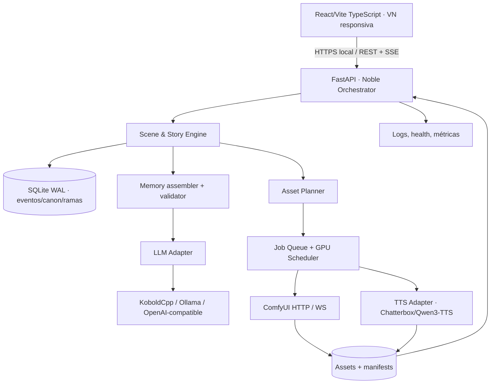

# Arquitectura técnica de Noble AI

Versión: 0.2 · Estado: diseño objetivo, no implementación verificada. **La prioridad APP-FIRST de ADR-002 agrega Model Hub + Runtime Supervisor y desplaza Colab a diagnóstico opcional.**

## 1. Topología



**Regla de frontera:** frontend solo llama al orchestrator. Ninguna credencial, puerto interno de ComfyUI, LLM o TTS debe exponerse directamente al navegador. Los tres motores externos son **procesos / proveedores** con adaptadores, no código copiado por defecto.

## 2. Estructura objetivo del repositorio

```text
novel_ai/
  README.md / AGENTS.md / .gitignore / .env.example
  docs/
    GDD_TECNICO.md ARQUITECTURA.md CONTRATOS_API.md
    ESTADO_Y_MEMORIA.md IMAGENES.md TTS.md PERFILES_GPU.md
    COLAB_A_LOCAL.md QA_Y_ACEPTACION.md ROADMAP.md
    PROGRESO.md REPOSITORIOS_OPEN_SOURCE.md SEGURIDAD_Y_LICENCIAS.md
    adr/
  apps/
    web/                  # React/Vite/TS: frontend propio adaptador de VN
    api/                  # FastAPI: historias, turnos, jobs, assets, config
  packages/
    contracts/            # OpenAPI + JSON Schema versionados (generados/validados)
  integrations/
    koboldcpp/            # adaptador HTTP OpenAI-compatible
    ollama/               # alternativa LLM
    comfyui/              # workflows/export, cliente HTTP/WS
    chatterbox/           # TTS opt-in
  data/                   # SOLO en runtime, no versionar
    noble.sqlite
    assets/               # CAS hash/manifest y archivos originales
    models/               # pesos externos
    logs/
  notebooks/
    noble_ai_colab_smoke.ipynb
  tests/
    contract/ integration/ e2e/ benchmarks/ fixtures/
  scripts/
    diagnose/ start/ build/
  .github/workflows/
```

Esta estructura es un **contrato organizativo**; crear carpetas vacías no cuenta como implementación. Incorporar cada carpeta con código real al llegar a su fase.

## 3. Backend recomendado: FastAPI + SQLAlchemy/Alembic + SQLite

- FastAPI con Pydantic para validar solicitudes y respuestas; contrato OpenAPI publicado bajo `/openapi.json`.
- SQLAlchemy + Alembic: control transaccional y migraciones versionadas.
- SQLite en modo WAL para instancia local; un proceso escritor lógico con cola de mutaciones. Evitar escrituras concurrentes no coordinadas desde workers.
- La historia es un **event log inmutable** y las vistas/materializaciones se reconstruyen. Branching explícito.
- Pydantic valida la propuesta de estado; la narrativa se guarda incluso si una extracción estructurada necesita revalidación.
- Assets en disco, sus identificadores, hash y metadatos en DB. Ruta del sistema de archivos nunca definida por un prompt LLM.
- Job queue ligera en DB para P1 (job_id, state, payload, attempts, priority, dedupe, timestamps, owner); no introducir Redis/Celery sin evidencia de necesidad.
- Streaming SSE `text_delta`, `turn_committed`, `job_queued`, `job_status`, `error`; reconexión con event_id o polling de respaldo.

## 4. Proveedores y adapters

**LLM:** interfaz `generate(messages, settings, stream, abort_signal)` con metadatos de modelo y contexto. Primario KoboldCpp `/v1/chat/completions` (API estilo OpenAI); alternativa Ollama `/api/chat` o ruta compatible según versión real. No asumir soporte uniforme de tool-calling/json-schema; exigir validación propia y fallback.

**Imágenes:** interfaz `submit_scene(workflow, vars) -> provider_job_id`, `status`, `result`, `cancel`. Primario ComfyUI: `POST /prompt`, `GET /history/{prompt_id}`, `GET /view`, WS `/ws`; workflows versión API exportados, sin confiar en nodos personalizados ausentes. Generar por necesidad y deduplicar.

**TTS:** interfaz `synthesize(text, voice_id, language, style) -> artifact` activada únicamente desde job con `requested_by=user/explicit_auto_mode`. Primario Chatterbox Multilingual (selección regional LatAm si disponible); alternativa Qwen3-TTS. Puede ejecutarse como subprocess/provider en entorno Python. No se carga al iniciar si el usuario no lo usa.

**Asset planner:** no confundir `narration_generated` con `scene_visual_change`. Recibe campos estructurados: location_id, appearance_version, cast_ids, expression, composition, time_of_day, art_style_version; calcula firma de caché, reusa y encola solo si hay cambio material/solicitud.

## 5. Estrategia GPU: un recurso exclusivo, varios servicios preparados

1. El LLM se inicia al abrir la sesión y **su API permanece lista**. Resident VRAM total no es una promesa en hardware de 12 GB.
2. Perfiles pueden descargar una fracción de capas de LLM a RAM (CPU offload) sin cerrar el proceso.
3. Imagen/TTS obtienen **lease de GPU** vía scheduler. No paralelizar dos trabajos pesados si las pruebas indican OOM.
4. Priorizar texto: `interactive_llm > explicit_tts > explicit_image > auto_image`. No abortar la generación en curso a mitad de escritura sin aceptación del usuario.
5. Si el LLM usa toda la VRAM, elegir previamente perfil reducido o transición segura: congelar entradas momentáneamente, checkpoint, mover capas/suspender proveedor de imagen, informar estado, reanudar. No declarar que GPU 12GB permite LLM 14B + SDXL + TTS simultáneamente.
6. Al terminar imagen/TTS, liberar memoria del worker cuando sea posible. Métricas nvidia-smi y torch.cuda registradas; evitar estimaciones sin medición.
7. Cancelación real por provider_job_id, expiración de lease, reintento limitado y recuperación de jobs huérfanos tras reinicio.

## 6. Casos de secuencia

### Generación narrativa

```
UI POST /turns {story_id, branch_id, mode, text, idempotency_key}
API valida historia + revisión y guarda intención pendiente
Story engine construye contexto determinístico del canon y memoria
Adapter invoca LLM y emite text_delta (SSE)
Validador produce evento(s) de estado y cambios de escena
Transacción: commit del turno + eventos + nueva revisión
Planner evalúa cambios visuales (puede devolver reuse/no_action/queue)
API emite turn_committed y opcional job_queued
UI muestra respuesta y escena actual, sin bloquearse por imágenes/TTS
```

### Imagen bajo demanda

```
Cambio material de escena / botón ilustrar
Planner compara firma de escena y assets disponibles
Si cache hit: asset listo (sin job)
Si no: job WAITING / cola GPU
ComfyUI POST /prompt → prompt_id; progreso vía WS/poll
Se guarda archivo y SHA-256, se valida tamaño/formato
DB asigna asset a escena_revision (solo si esa revisión sigue activa)
UI cambia el fondo/sprite suavemente; respuesta narrativa nunca se pierde
```

### Audio bajo demanda

```
Usuario pulsa escuchar o activa autolectura explícita
API autoriza y deduplica por hash voz+modelo+idioma+texto
Job TTS ocupa lease de GPU cuando corresponde
Audio disponible por asset_id; reproducir solo si la UI aún corresponde
Si se abandona/reintenta la rama: audio viejo no se autoinyecta
```

## 7. Contratos de fallas

- **LLM caído**: fallo visible/reintentable, sin turno committeado a medias; se conserva texto del usuario como draft.
- **ComfyUI caído**: texto y guardado operan, job failed/queued, posibilidad de reintentar; fondo anterior continúa.
- **TTS caído**: botón informa error; no reintentos automáticos silenciosos.
- **GPU OOM**: registrar hardware/modelos/pico, hacer cleanup y bajar perfil recomendado; nunca ciclar sin límite.
- **SSE desconectado**: UI consulta turno por idempotency_key/turn_id, no duplica transacción.
- **JSON LLM inválido**: narración puede presentarse como preview, pero canon no cambia hasta validación; reintento determinístico limitado.
- **Timeout de imágenes**: job conserva prompt_id para poder recuperar sin duplicar.

## 8. Seguridad de servicios

Localidad por defecto (127.0.0.1), autenticación/token de sesión al habilitar LAN/Colab pública, CORS explícito, paths de asset por IDs, tipos MIME y tamaños controlados, sin comandos shell/control de archivos producidos por LLM. Ver documento de seguridad.

## 9. Pruebas de integración exigidas

Contract tests de cada adaptador; smoke backend sin GPU; smoke con un modelo real en Colab si disponible; prueba de 12/16 GB local; simulación de caídas; Playwright escritorio/móvil; trazabilidad de un job desde disparador hasta asset final. Ver [QA](QA_Y_ACEPTACION.md).

## 10. Capa APP-FIRST: Model Hub, proveedores, configuración y desktop

**Ruta al primer incremento:**
```text
React/Vite (Wizard + Model Hub + Downloads + Settings + Story VN)
      ↓ REST/SSE
FastAPI Control Plane
   ├─ Hardware Discovery (GPU/CPU, RAM, drivers y dispositivos)
   ├─ Model Catalog (HF search, metadata, quant variants, license)
   ├─ Download Manager (jobs, pause/resume/cancel, hash, registry)
   ├─ Provider Registry (LLM/image/TTS local o remoto; capabilities)
   ├─ Model Assignments + Profiles (global, por historia, versionado)
   ├─ Runtime Supervisor (instalar/iniciar/parar/swap y health)
   ├─ Story Engine + SQLite (event log, memory, branches)
   └─ GPU scheduler (texto prioritario; imagen/TTS lazy)
      ↓ procesos aislados
KoboldCpp/Ollama | ComfyUI | Chatterbox | API-compatible providers
      ↑
Tauri 2 / WebView (shell Windows futuro; mismo frontend y backend)
```

### Entidades adicionales persistentes

`provider_connection` (sin claves en DB), `runtime_installation` (versión/ruta/estado), `model_catalog_entry` (metadata remoto cacheado), `model_variant` (ficheros/revision/quant), `installed_model` (referencias hash), `download_job` (status y bytes), `model_assignment` (función/provider/model/settings/device), `profile` (global/historia), `hardware_snapshot` (perfil efectivo y mediciones).

**Diferenciar origen de modelo (descubierto) de archivo instalado y motor ejecutor.** El frontend no hace llamadas directas a Hugging Face ni registra llaves de proveedor; backend hace cache/paginación y gestión de credenciales. No ejecutar código remoto de modelos en instalación.

### Lifecycle

El **control plane** se inicia sin modelos ni GPU pesada. Solo cuando hay historia activa arranca el LLM seleccionado, cuya API permanece atendible durante la sesión, con GPU total/parcial/CPU según configuración. Los modelos de imagen ocupan GPU al cambiar escena/solicitud y liberan recursos según scheduler. Los de voz **no** se precargan, aun cuando el usuario abra Ajustes. Cambio de modelo con preflight de RAM/VRAM, guardado/timeout, stop/unload, start/health y rollback.

### Frontend y empaquetado

Vite/React/TS en web local, luego Tauri 2 con Python FastAPI empaquetado como sidecar. No mezclar Tauri internamente con implementación de motor. El backend valida sesión/puerto local, arranca/finaliza solo procesos propios, deja servicios externos compartidos intactos. Registro de modelos y datos fuera del binario; wizard visual y recuperación de settings.

### Contratos y dependencias

Ver [Model Hub](MODEL_HUB.md), [Onboarding UI](ONBOARDING_Y_UI.md) y [Desktop](DESKTOP_Y_DESPLIEGUE.md). Nuevo orden: Model Hub/Downloads/Settings → narrator runtime → Story engine/VN → imagen → TTS → empaquetado. El viejo notebook Colab se conserva solo para investigación opcional.
